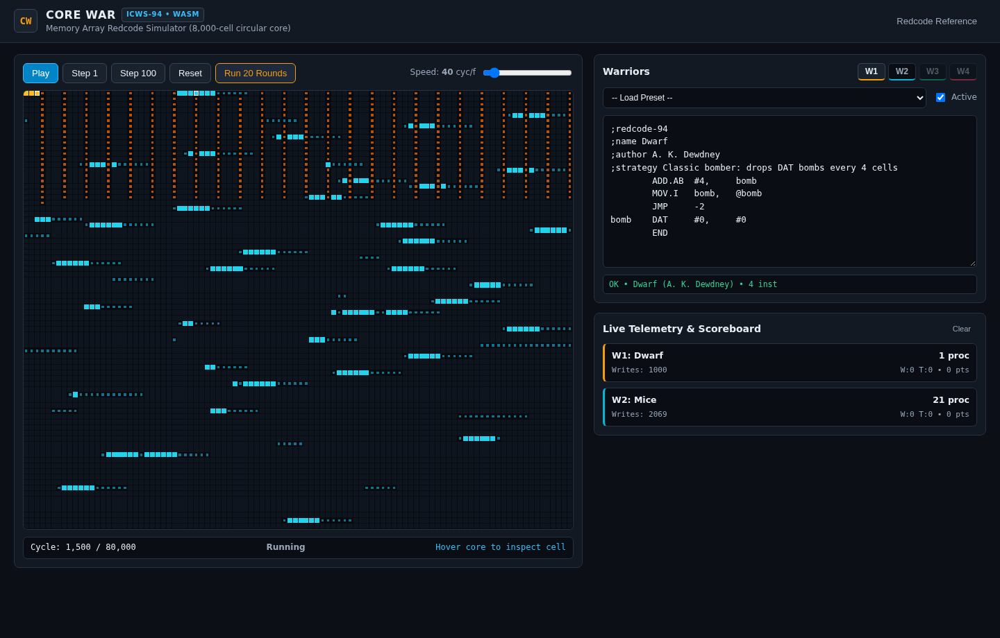

# Core War — Rust / WebAssembly (ICWS-94 MARS)

An interactive **Core War** Memory Array Redcode Simulator (**MARS**) and **ICWS-94 Redcode** assembler built in **Rust** and compiled to **WebAssembly** (`wasm32-unknown-unknown`), featuring a 60fps HTML5 Canvas core visualizer, live Redcode editor, cell disassembler, and multi-round tournament runner.



## Features

- **ICWS-94 Redcode Assembler** (`src/parser*.rs`):
  - Full 16-opcode set: `DAT`, `MOV`, `ADD`, `SUB`, `MUL`, `DIV`, `MOD`, `JMP`, `JMZ`, `JMN`, `DJN`, `SPL`, `SEQ`/`CMP`, `SNE`, `SLT`, `NOP`
  - All 7 instruction modifiers: `.A`, `.B`, `.AB`, `.BA`, `.F`, `.X`, `.I` with ICWS-94 default modifier inference
  - All 8 addressing modes: `#` (immediate), `$` (direct), `*` / `@` (A/B indirect), `{` / `<` (A/B pre-decrement), `}` / `>` (A/B post-increment)
  - Labels, `EQU` macros, arithmetic expressions, `ORG` / `END`, and `;name` / `;author` / `;strategy` metadata
- **MARS Virtual Machine** (`src/vm*.rs`):
  - 8,000-cell circular memory core (`CORESIZE = 8000`, `MAXCYCLES = 80000`, `MAXPROCESSES = 8000`)
  - Round-robin FIFO process queues per warrior (up to 4 simultaneous warriors)
  - Multi-round match runner with rotating starting order and `MINDISTANCE` placement
- **Interactive Web UI** (`web/`):
  - 100×80 (8,000-cell) Canvas core visualizer highlighting instructions, `DAT` bombs, memory writes, and active PCs
  - Hover any cell to disassemble its live ICWS-94 instruction
  - Built-in classic presets: **Dwarf**, **Imp**, **Mice**, **Silk Warrior**, **Myrmidon Scanner**, **Pit Vampire**

## Quick Start

### 1. Run Unit & Integration Tests

```bash
cargo test
```

### 2. Build the WebAssembly Binary

```bash
rustup target add wasm32-unknown-unknown
./build.sh
```

This compiles `corewar.wasm` and copies it to `web/corewar.wasm`.

### 3. Launch the Game

Serve the `web/` directory with any static HTTP server:

```bash
python3 -m http.server 8080 -d web
```

Then open `http://localhost:8080` in your browser.

## Project Structure

Every source file is kept modular and under 200 lines of code:

- `src/types.rs`, `src/mars_math.rs` — Core ICWS-94 types and modular arithmetic
- `src/parser.rs`, `src/parser_line.rs`, `src/parser_expr.rs` — Multi-pass Redcode assembler
- `src/vm.rs`, `src/vm_eval.rs`, `src/vm_exec.rs` — MARS simulator and instruction execution
- `src/disasm.rs`, `src/presets.rs`, `src/wasm_api.rs` — Disassembler, presets, and WASM C-ABI
- `tests/` — Assembler, opcode/mode, and warrior battle tests
- `web/` — Zero-framework HTML/CSS/JS frontend and `corewar.wasm`
